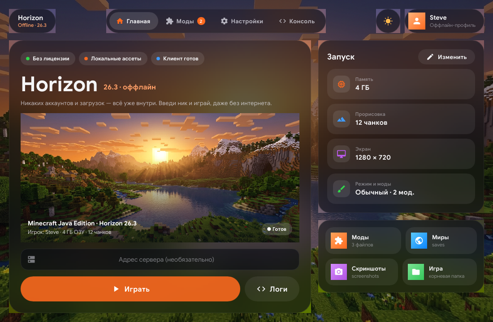
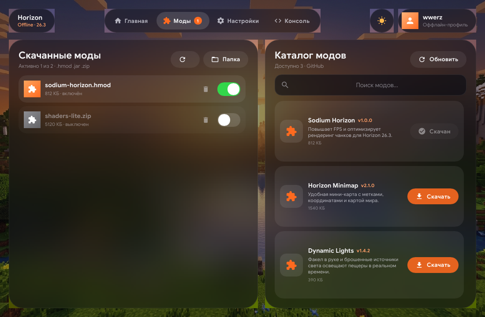
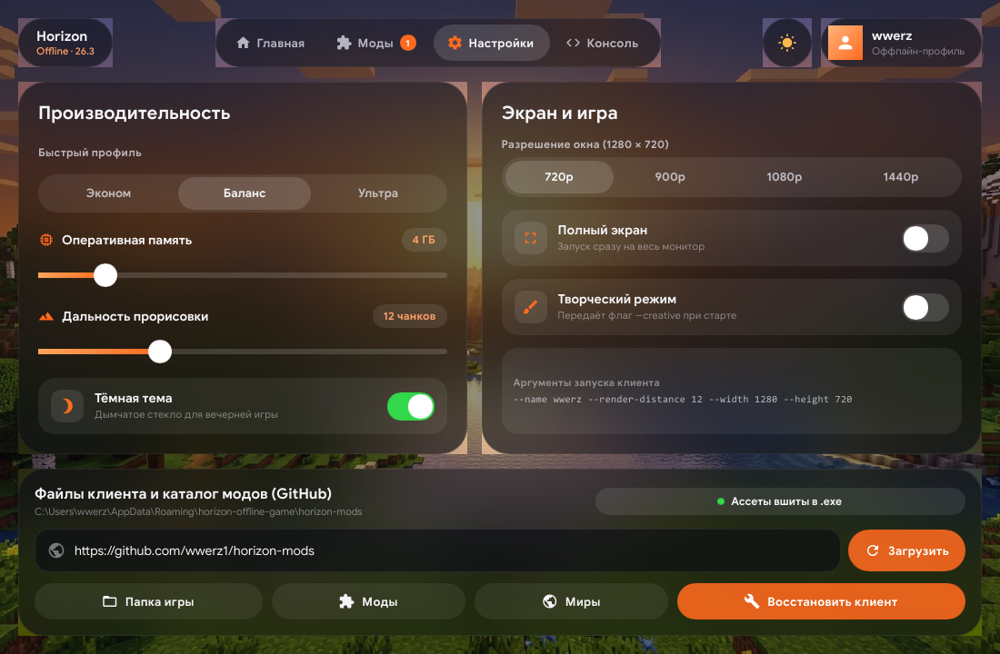

<p align="center">
  
</p>

<h1 align="center">Horizon Offline Launcher</h1>

<p align="center">
  <strong>Автономный оффлайн-лаунчер на Rust + Slint с дизайном iOS Liquid Glass, встроенными ассетами 26.3 и каталогом модов.</strong>
</p>

<p align="center">
  
  
  
  
  
</p>

---

## ✨ Особенности

* 🔓 **Полностью без лицензии (Offline Mode)**  
  Никаких аккаунтов Microsoft и онлайн-авторизации — просто введи любой никнейм и нажми «Играть».
* 📦 **Все ассеты встроены в один `.exe` (Zero-Download)**  
  Клиент Horizon 26.3 и все 28 000+ ресурсов уже упакованы внутрь исполняемого файла. При первом запуске лаунчер автоматически распаковывает клиент — работает даже без интернета.
* 🫧 **Интерфейс iOS Liquid Glass + 144 Гц анимации**  
  Матовое полупрозрачное стекло, светлая и тёмная темы, нативная физическая пружина (`spring`) при перетаскивании капли в таб-баре и сегмент-контролах, плавные переходы на 144 Гц.
* 🧩 **Встроенный каталог модов (GitHub)**  
  Двухколоночная вкладка «Моды»: слева твои установленные моды с тумблером вкл/выкл и удалением, справа — онлайн-каталог из репозитория [horizon-mods](https://github.com/e04059631-lab/horizon-mods) со скачиванием в один клик.
* ⚙️ **Гибкие настройки запуска**  
  Быстрые профили производительности (`Эконом` / `Баланс` / `Ультра`), выбор ОЗУ и дальности прорисовки, пресеты разрешения, полноэкранный и творческий режимы, прямой вход на сервер и живая консоль логов с фильтрацией.

---

## 📸 Скриншоты

<p align="center">
  
  
</p>
<p align="center">
  
</p>

---

## 🎮 Скачать (Releases)

Готовый автономный `.exe` со всеми встроенными ассетами Horizon 26.3 доступен на странице релизов:

👉 **[Скачать Horizon Offline Launcher v2.0.0](https://github.com/e04059631-lab/horizon-offline-launcher/releases/tag/v2.0.0)**

| Файл | Платформа | Размер | Описание |
| :--- | :--- | :--- | :--- |
| **`horizon-offline-launcher.exe`** | Windows 10 / 11 (x64) | ~392 МБ | Полностью автономный портативный `.exe` со встроенным клиентом и ассетами 26.3 |

---

## 🧩 Каталог модов

Официальный репозиторий модов: **[e04059631-lab/horizon-mods](https://github.com/e04059631-lab/horizon-mods)**  
Адрес каталога также можно изменить прямо в лаунчере (**Настройки → Файлы клиента и каталог модов**).

---

## 🛠 Сборка из исходников

```bash
git clone https://github.com/e04059631-lab/horizon-offline-launcher.git
cd horizon-offline-launcher
cargo build --release
```

Для упаковки собранного бинарника вместе с архивом ассетов (`HORIZON_PAYLOAD`) используется скрипт `pack_release.ps1`.

---

## ⚖️ Лицензия

Исходный код распространяется под лицензией [MIT](LICENSE).  
Minecraft является зарегистрированной торговой маркой Mojang Studios / Microsoft. Проект является независимым фанатским форком.
