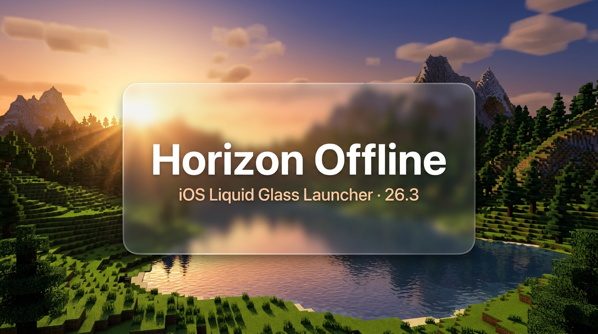

<p align="center">
  
</p>

<h1 align="center">Horizon Offline Launcher</h1>

<p align="center">
  <strong>Автономный оффлайн-лаунчер для Minecraft Horizon 26.3 на Rust + Slint со встроенным клиентом, адаптивной темой, CLI-командами и онлайн-каталогом шейдеров и PvP-паков.</strong>
</p>

<p align="center">
  
  
  
  
  
</p>

---

## ✨ Возможности

* 🔓 **Полностью без лицензии (Offline Mode)**  
  Без аккаунтов Microsoft и онлайн-авторизации — достаточно ввести любой никнейм и нажать «Играть».
* 📦 **Все ассеты встроены в один файл (Zero-Download)**  
  Нативный клиент Horizon 26.3 и все 29 000+ ресурсов упакованы внутрь одного исполняемого файла (и на Windows, и на Linux). При первом запуске лаунчер автоматически распаковывает клиент — можно играть полностью оффлайн.
* 🎨 **Живые фоны и адаптивный акцент**  
  4 игровых фона Minecraft с шейдерами + выбор собственного изображения («Свой фон»). Акцентный цвет всего интерфейса — кнопки, слайдеры, переключатели и сама иконка **H** — автоматически подстраивается под выбранные обои. Поддерживаются тёмная и светлая темы.
* 🧩 **Онлайн-каталог на 56 клиентских дополнений**  
  Полноширинная вкладка «Моды» с переключателем **Каталог / Мои**, поиском и фильтрами (`Все`, `Шейдеры`, `PvP-паки`):
  * **27 нативных WGSL-шейдеров** (`.hshader`) с поддержкой объединения нескольких шейдеров одновременно;
  * **29 клиентских PvP и QoL ресурс-паков** (`.zip`), работающих и в одиночной игре, и на любом сервере.
* ⌨️ **Встроенные CLI-команды**  
  Запуск игры, распаковка клиента, просмотр статуса/модов и установка ярлыка в систему прямо из терминала (`horizon-launcher --help`).

---

## 🐧 Установка на Linux (одной командой)

Поддерживаются все современные 64-битные дистрибутивы (Ubuntu 22.04+, Debian 12+, Fedora, Arch, Mint, Pop!_OS, SteamOS):

```bash
curl -fsSL https://raw.githubusercontent.com/xwwerz/horizon-offline-launcher/main/install-linux.sh | bash
```

Скрипт сам скачает автономный бинарник со встроенным клиентом Horizon 26.3 (~404 МБ), установит команду `horizon-launcher` в `~/.local/bin` и добавит ярлык с иконкой в меню приложений.

Удаление:

```bash
horizon-launcher --uninstall
```

---

## 🪟 Скачать для Windows и Linux (Releases)

Готовые автономные сборки со всеми встроенными ассетами Horizon 26.3 доступны на странице релизов:

👉 **[Перейти к релизам Horizon Offline Launcher](https://github.com/xwwerz/horizon-offline-launcher/releases/latest)**

| Файл | Платформа | Размер | Описание |
| :--- | :--- | :--- | :--- |
| **`horizon-offline-launcher.exe`** | Windows 10 / 11 (x64) | ~392 МБ | Автономный `.exe` со встроенным клиентом и ассетами 26.3 |
| **`horizon-offline-launcher-linux-x86_64`** | Linux (x86_64) | ~404 МБ | Автономный бинарник со встроенным Linux-клиентом 26.3 и CLI-командами |

---

## ⌨️ Встроенные команды (`horizon-launcher`)

| Команда | Описание |
| :--- | :--- |
| `horizon-launcher` | Открыть графический интерфейс лаунчера |
| `horizon-launcher --play [ник] [--server ip]` | Запустить игру сразу из терминала (автоматически распакует клиент при первом запуске) |
| `horizon-launcher --install` | Установить бинарник в `~/.local/bin`, иконку и ярлык `.desktop` (Linux) |
| `horizon-launcher --uninstall [--purge]` | Удалить лаунчер и ярлык (`--purge` также удалит миры и настройки) |
| `horizon-launcher --status` | Показать статус установки клиента, пути, ник и каталог модов |
| `horizon-launcher --unpack [--force]` | Распаковать встроенный клиент Horizon 26.3 в терминале |
| `horizon-launcher --mods` | Показать список установленных шейдеров и PvP-паков |
| `horizon-launcher --version` / `--help` | Показать версию и справку по командам |

---

## 🧩 Каталог модов

Официальный репозиторий шейдеров и PvP-паков: **[xwwerz/horizon-mods](https://github.com/xwwerz/horizon-mods)**  
Адрес каталога можно в любой момент изменить прямо в лаунчере (**Настройки → Каталог и файлы**).

---

## 🛠 Сборка из исходников

```bash
git clone https://github.com/xwwerz/horizon-offline-launcher.git
cd horizon-offline-launcher
cargo build --release
```

Для упаковки бинарника вместе с архивом ассетов (`HORIZON_PAYLOAD`) используются `pack_release.ps1` (Windows) и `pack_linux.py` (Linux).

---

## ⚖️ Лицензия

Исходный код распространяется под лицензией [MIT](LICENSE).  
Minecraft является зарегистрированной торговой маркой Mojang Studios / Microsoft. Проект является независимым фанатским форком.
